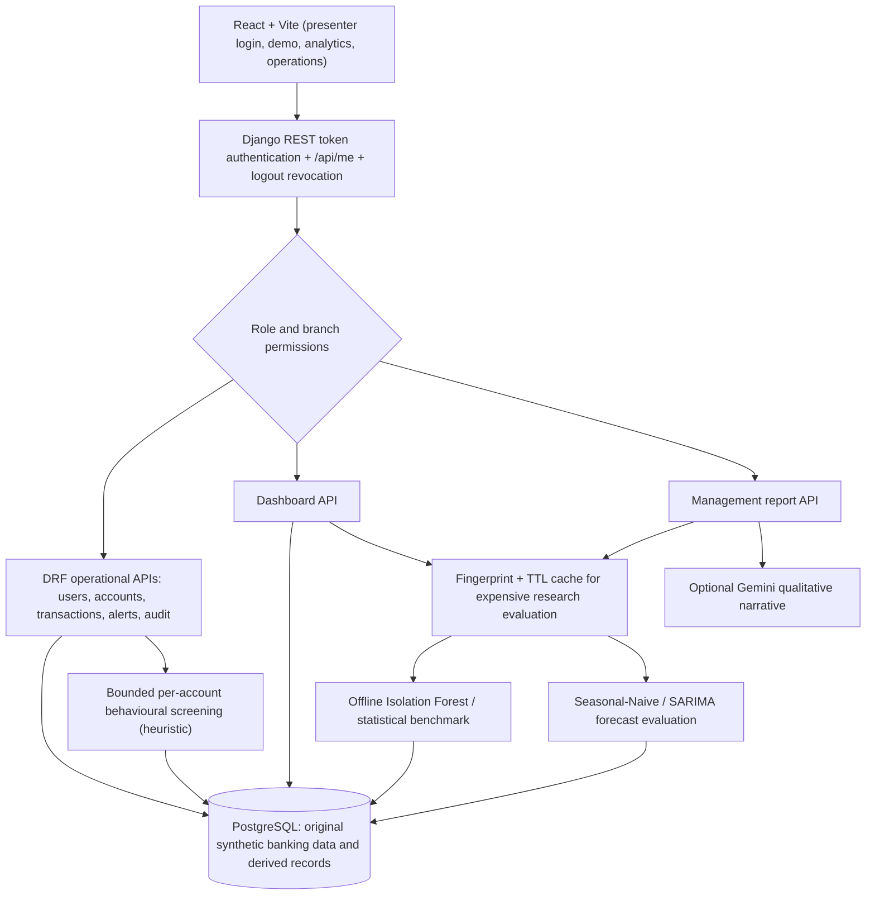
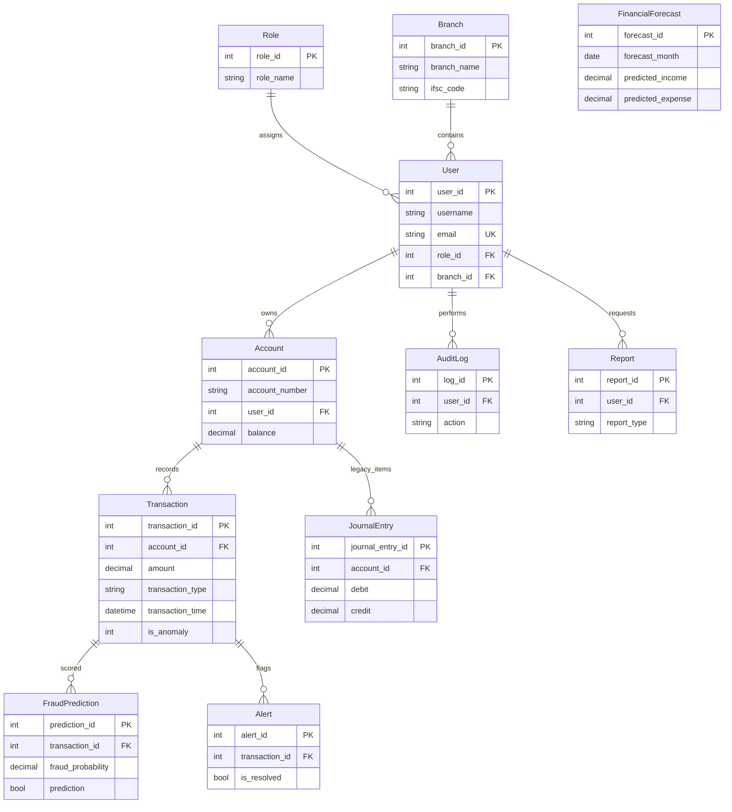
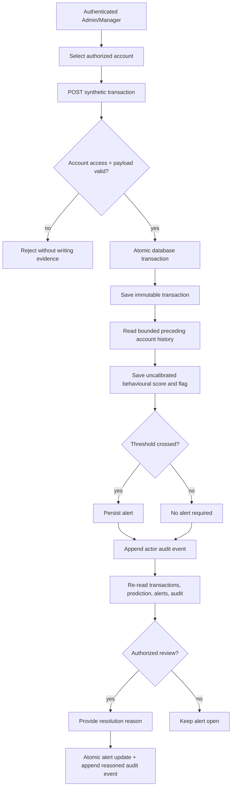
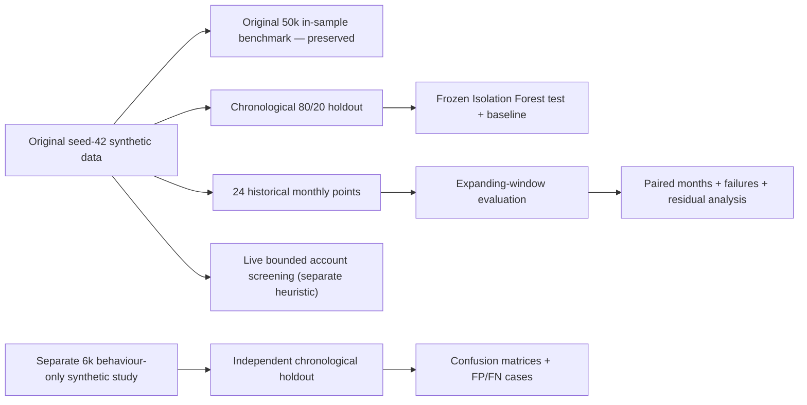

# AI Finance System — Verified Architecture and Data Model

**Architecture scope:** source in `Abhijith513/AI-Finance-System`, recovery branch `rescue/submission-critical-fixes` (October 2026). Diagrams describe the actual prototype contracts. They are editable Mermaid source and **not** screenshots or claims of deployed banking infrastructure.

## Figure A — Runtime architecture

**Important:** The synchronous live screening path does **not** run Isolation Forest on every transaction. That model belongs to the separately evaluated offline research experiment. Only Admin can run the full guided demo; Admin/Manager can access branch-restricted operational paths; global analytics and AI reporting require Admin/Analyst permissions.

## Figure B — Source-grounded database relationships

Notes: The original `JournalEntry` table is historical and does **not** enforce balanced postings; it is not a reliable general ledger. `FinancialForecast` is institution-wide and does not have an account foreign key. A separate balanced synthetic-ledger extension, if accepted, is documented independently and must not be mistaken for the legacy `JournalEntry` records.

## Figure C — Real transaction and alert investigation dataflow

## Figure D — Research evaluation versus live operations

## Security and methodological limits

- Passwords must be hashed; token logout revokes the token in Django. Permissions are verified on the server, not only by hiding React tabs.
- Admin and Manager operational permissions are distinct from global Analyst access. Branch access is evaluated on the authoritative account-to-user-to-branch relationship.
- The alert evidence cannot be directly created, deleted or overwritten through normal API operations. Resolution is an audited and reasoned action.
- Research caching has a bounded TTL. A cache hit does not imply scientific revalidation; the original evaluation provenance must be preserved.
- No real bank customers, actual payments, calibrated fraud-risk probabilities, model causal feature explanations, or real-world security certification are claimed.

## Validation requirements

1. Review the Mermaid diagrams against `finance/models.py`, `finance/views.py`, `finance/urls.py`, `frontend/src/DemoExperience.jsx` and `frontend/src/OperationalWorkspace.jsx`.
2. Update diagrams if the isolated balanced ledger introduces new models and APIs.
3. Export genuine diagrams for final report only **after** the version is frozen, with figure numbers and revision SHA.
